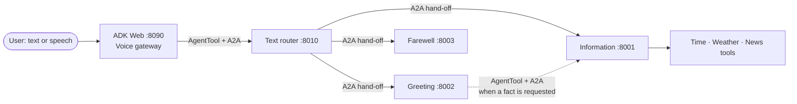

# Local agents, connected with A2A

**A voice-enabled, multi-agent application built with Google Agent Development Kit (ADK), Ollama, and the Agent2Agent (A2A) protocol.** A local text model routes requests to independently served agents for greetings, live information, and farewells. Gemini speech services add voice input and output.

The project demonstrates how an agent can delegate a turn to a remote specialist, or call another agent as a tool and use its result to compose a response. It is a local development and learning implementation, with explicit service boundaries that make those interactions visible.

[Get started](#get-started) · [Architecture](#architecture) · [Try it](#try-it) · [Learning guide](learning.md) · [Official references](#official-references)

## Architecture



The gateway uses ADK's `CascadeLive`: Gemini speech-to-text → a local Ollama-backed text model → Gemini text-to-speech. It calls the router as an A2A-backed `AgentTool`. The router delegates to one of three remote specialists; the greeting specialist can in turn call information as a tool. See the [learning guide](learning.md) for the reasoning behind these choices and a request-by-request walkthrough.

| Component | Responsibility | Model / service |
| --- | --- | --- |
| Voice gateway | Receives text or speech and relays the router's answer | Qwen 3.5 4B via Ollama; Gemini STT/TTS |
| Router | Selects a specialist or explains the available capabilities | Qwen 3.5 4B via Ollama |
| Information | Looks up current time, weather, and news | Qwen 3.5 4B and Python tools |
| Greeting | Handles greetings; consults information for a requested live fact | Qwen 3.5 4B |
| Farewell | Handles simple thanks and goodbyes | LFM 2.5 8B |

The reasoning models run locally, but the whole application is **not offline**: Gemini speech, weather, and NewsAPI requests use external services. Voice requires a Google API key; news requires a NewsAPI key. Check the providers' current [pricing](https://ai.google.dev/gemini-api/docs/pricing) and [terms](https://ai.google.dev/gemini-api/terms) before sending sensitive data or enabling billing.

## Get started

The commands below target **Windows PowerShell** and assume a checkout of this repository. They use Python 3.12, the project's pinned dependencies, and a running [Ollama installation](https://ollama.com/download).

### 1. Install dependencies

From the repository root:

```powershell
py -3.12 -m venv .venv
.\.venv\Scripts\Activate.ps1
python -m pip install --upgrade pip
python -m pip install -r requirements.txt
```

The project pins LiteLLM to `1.105.1` after tool-call import failures were encountered with `1.108.0`. Recheck compatibility if changing the versions in [`requirements.txt`](requirements.txt).

### 2. Configure keys

Create the local configuration from the example, then edit it:

```powershell
if (!(Test-Path my_agent\.env)) { Copy-Item my_agent\.env.example my_agent\.env }
notepad my_agent\.env
```

Set `GOOGLE_API_KEY` to a key from [Google AI Studio](https://aistudio.google.com/apikey) for voice, and `NEWSAPI_API_KEY` to a key from [NewsAPI](https://newsapi.org/register) for news. News tools return a clear error if their key is missing. Existing environment variables take precedence over values in `.env`. Keep the real `.env` private and never commit keys.

### 3. Prepare the local models

Start Ollama, then pull the models (downloads can take time and disk space):

```powershell
ollama pull qwen3.5:4b
ollama pull lfm2.5:8b
```

Confirm they are available with `ollama list`. Model performance and latency depend on the available hardware.

### 4. Start the services

Open **four separate PowerShell terminals** in the repository root. Run one command in each and leave it running:

```powershell
.\.venv\Scripts\python.exe -m uvicorn my_agent.a2a_services:information_a2a_app --host 127.0.0.1 --port 8001
```

```powershell
.\.venv\Scripts\python.exe -m uvicorn my_agent.a2a_services:greeting_a2a_app --host 127.0.0.1 --port 8002
```

```powershell
.\.venv\Scripts\python.exe -m uvicorn my_agent.a2a_services:farewell_a2a_app --host 127.0.0.1 --port 8003
```

```powershell
.\.venv\Scripts\python.exe -m uvicorn my_agent.a2a_services:router_a2a_app --host 127.0.0.1 --port 8010
```

In a fifth terminal, start the development interface:

```powershell
.\.venv\Scripts\adk.exe web --port 8090 my_agent
```

Open [http://127.0.0.1:8090](http://127.0.0.1:8090), select `my_agent`, and enter a message or use voice. Stop each process with **Ctrl+C** in its terminal. The service terminals show startup messages and request logs.

### 5. Check discovery

Each A2A service publishes an Agent Card. With the four services running, inspect them from another terminal:

```powershell
8001, 8002, 8003, 8010 | ForEach-Object {
    $card = Invoke-RestMethod "http://127.0.0.1:$_/.well-known/agent-card.json"
    [pscustomobject]@{
        Port = $_
        Name = $card.name
        Endpoint = $card.supportedInterfaces[0].url
        Skills = $card.skills.Count
    }
}
```

Port `8010` is also the router's entry point for external A2A clients. A browser GET to a service's base URL can return `405 Method Not Allowed`; use the Agent Card URL for discovery and an A2A client for protocol requests.

## Try it

| Request | Intended path |
| --- | --- |
| “Hello!” | Router → greeting |
| “What time is it in New Delhi?” | Router → information → time tool |
| “Hi, what is the weather in Little Rock, Arkansas?” | Router → greeting → information → weather tool → greeting |
| “What are the top US technology headlines?” | Router → information → category news tool |
| “Thank you, goodbye.” | Router → farewell |

These routes are driven by model instructions, so model output can vary. A factual request that also says goodbye is directed to information so the question is addressed. The included evaluation set currently contains **no evaluation cases**; the examples above are manual checks, not a claim of automated coverage.

## Troubleshooting

- **An Agent Card is unavailable:** check the corresponding Uvicorn terminal, port, and startup errors. All four services are needed for the full gateway flow.
- **A model is unavailable or slow:** check `ollama list`, confirm Ollama is running, and inspect the service terminal. The configured model names must match the pulled models.
- **Voice fails:** check `GOOGLE_API_KEY`, API access and quota, network connectivity, and browser microphone permissions. Check the gateway terminal for errors.
- **News fails or returns no articles:** check `NEWSAPI_API_KEY`, the service response, and the query. Topic and category searches use different filters; an empty result can be legitimate.
- **Dependencies conflict:** run `.\.venv\Scripts\python.exe -m pip check` and compare the environment with [`requirements.txt`](requirements.txt).

These services and ADK Web are configured for loopback development. ADK Web's endpoints are unauthenticated; do not expose this setup to an untrusted network without appropriate security and deployment work.

## Repository map

| File | Purpose |
| --- | --- |
| [`my_agent/agent.py`](my_agent/agent.py) | Voice gateway, local data tools, and router client |
| [`my_agent/a2a_services.py`](my_agent/a2a_services.py) | Router, specialists, remote clients, and A2A service applications |
| [`my_agent/.env.example`](my_agent/.env.example) | Configuration template; copy it locally and supply your own keys |
| [`my_agent/eval_set_1.evalset.json`](my_agent/eval_set_1.evalset.json) | Currently empty ADK evaluation set |
| [`learning.md`](learning.md) | Concepts, sequence diagrams, design choices, and further reading |
| [`requirements.txt`](requirements.txt) | Pinned direct dependencies |

## Official references

- [Google ADK: expose an agent over A2A](https://github.com/google/adk-docs/blob/main/docs/a2a/quickstart-exposing.md) and [consume a remote agent](https://github.com/google/adk-docs/blob/main/docs/a2a/quickstart-consuming.md)
- [Google ADK: cascade voice architecture](https://github.com/google/adk-docs/blob/main/docs/live/architectures/cascade.md) and [Agent-as-a-Tool](https://github.com/google/adk-docs/blob/main/docs/tools-custom/function-tools.md#agent-tool)
- [Google ADK: Ollama integration](https://github.com/google/adk-docs/blob/main/docs/agents/models/ollama.md) and [A2A protocol specification](https://a2a-protocol.org/latest/specification/)
