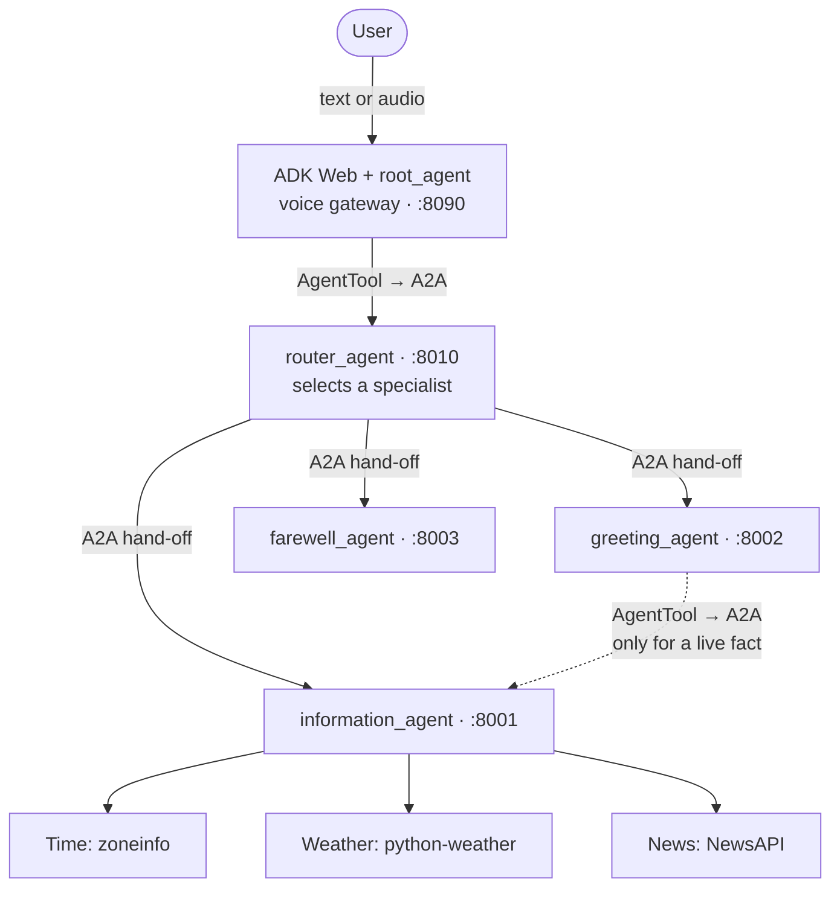
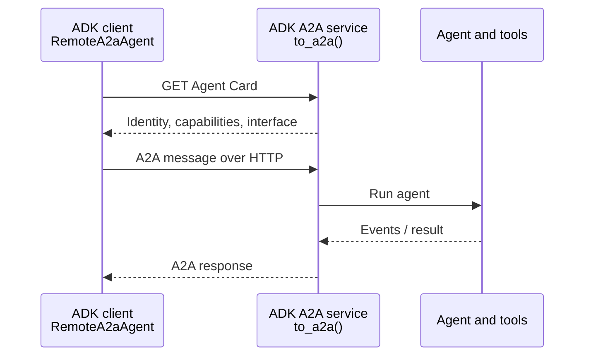
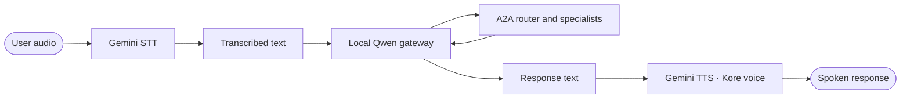

# A practical guide to ADK, A2A, and live voice

This guide follows a request through the application and explains the engineering decisions behind it. It covers agent orchestration, remote service discovery, model and tool boundaries, and the live voice runtime. Start with the [README](README.md) for installation and commands.

**Reading path:** [Core concepts](#1-core-concepts) → [Architecture](#2-architecture-and-responsibilities) → [A2A boundary](#3-what-crosses-the-a2a-boundary) → [Delegation](#4-two-ways-to-compose-agents) → [Voice](#5-live-voice-and-the-cascade) → [Operational design](#6-operational-design) → [Further learning](#7-beyond-this-implementation).

## 1. Core concepts

An **agent** combines a role, instructions, a model, and optionally tools or other agents. The model interprets a request and selects an action; the runtime manages the invocation and executes the selected tools. A **tool** is a callable operation with a specific capability, such as looking up weather. A tool result is evidence the agent can use to answer; a model alone does not make a fact current.

Google's **Agent Development Kit (ADK)** provides the agent definitions, tool integration, orchestration, runtime, and development interface used here. Despite the frequent association between ADK and Gemini, ADK can work with other models. In this project, `LiteLlm` connects the reasoning agents to Ollama, while Gemini provides the speech components. See the official [ADK Ollama integration](https://github.com/google/adk-docs/blob/main/docs/agents/models/ollama.md).

The **Agent2Agent (A2A) protocol** describes how a client and an agent service communicate across a service boundary. It gives clients a way to discover an agent and exchange messages and tasks without depending on that agent's internal framework, model, or tool implementation. Here, both ends happen to use ADK, but that is not a protocol requirement. See the [A2A core concepts](https://a2a-protocol.org/latest/topics/key-concepts/).

| Concern | What handles it here |
| --- | --- |
| Role, instructions, tool selection, and routing | ADK agents and the configured models |
| Tool execution | ADK and Python functions |
| Communication between independently served agents | A2A, through ADK's client and server adapters |
| Local model inference | Ollama, accessed through LiteLLM |
| Speech recognition and synthesis | Gemini speech providers through ADK's `CascadeLive` |

## 2. Architecture and responsibilities



The browser-facing `root_agent` is the gateway. It is instructed to forward the complete request to the router and relay the response. The router selects a specialist based on its instructions and the specialists' descriptions. Information owns the data tools; greeting owns the social response and can consult information; farewell handles simple sign-offs. Requests outside the advertised capabilities receive a brief explanation from the router.

The gateway uses an `AgentTool` around a `RemoteA2aAgent` that points to the router. The router's `sub_agents` are remote clients, not local copies of the specialist implementations. The router and three specialists are each exposed as an A2A app using `to_a2a()` in [`a2a_services.py`](my_agent/a2a_services.py).

### Trace a mixed request

For “Hi, what is the weather in Little Rock, Arkansas?” the **intended** flow is:

```mermaid
sequenceDiagram
    autonumber
    actor User
    participant Gateway as Voice gateway
    participant Router as Router :8010
    participant Greeting as Greeting :8002
    participant Info as Information :8001
    participant Weather as Weather tool
    User->>Gateway: Greeting + weather question
    Gateway->>Router: AgentTool call over A2A
    Router->>Greeting: Delegate turn over A2A
    Greeting->>Info: AgentTool call over A2A
    Info->>Weather: Get current weather
    Weather-->>Info: Conditions or error
    Info-->>Greeting: Information result
    Greeting-->>Router: Greeting + answer
    Router-->>Gateway: Specialist response
    Gateway-->>User: Relay response; synthesize speech for voice
```

A plain greeting should stop at greeting. A time or news question without a greeting should go directly to information. A simple goodbye should go to farewell. These are instruction-driven behaviors, not deterministic guarantees: a model can choose an incorrect route or tool, and calls can fail. The included evaluation set is empty, so these scenarios need to be tested rather than assumed.

## 3. What crosses the A2A boundary

### Discovery and invocation

Each service publishes an **Agent Card**, a machine-readable description of its identity, capabilities, skills, supported interface, and endpoint. In this local configuration, cards are available at `/.well-known/agent-card.json` on ports `8001`, `8002`, `8003`, and `8010`.

The client uses the card to find out how to reach the service, then sends an A2A message using a supported protocol binding. The receiver runs its agent and returns a message or task information. A task can represent work that progresses over time; messages contain parts carrying the actual content. A2A supports more than one transport and interaction pattern: HTTP/JSON-RPC is the relevant interface for this setup, while streaming and other bindings are protocol capabilities that should be checked against a service's card.



`RemoteA2aAgent` adapts a remote service to ADK's agent interface. `to_a2a()` exposes an ADK agent through an A2A server. They handle protocol details that the application would otherwise need to implement itself. The service boundary is real even though the processes all run on one machine: discovery, serialization, networking, availability, and errors still matter.

The code sets `use_legacy=False` on remote clients. The exact wire schema and operations depend on the installed ADK and A2A SDK versions and the advertised binding; use the matching [ADK consuming guide](https://github.com/google/adk-docs/blob/main/docs/a2a/quickstart-consuming.md) and [A2A specification](https://a2a-protocol.org/latest/specification/) when building a separate client. A conceptual diagram is more useful here than a partial JSON payload that may not be valid for the installed protocol version.

### What A2A does and does not provide

A2A defines a shared way to interact with agent services; it does not dictate their model, prompts, internal tools, or quality. It also does not automatically supply production authentication, authorization, privacy, reliability, or observability. The local services use loopback addresses and should be treated as development services.

An Agent Card describes a capability; it is not proof that the agent will always execute it correctly. Likewise, an HTTP connection error, a failed tool, and a misleading model response are different failure modes and should be investigated separately.

## 4. Two ways to compose agents

ADK supports both delegation and using an agent as a tool. The distinction is who is expected to produce the final answer.

| Pattern | Project example | Control flow |
| --- | --- | --- |
| **Sub-agent hand-off** | Router → specialist | The router delegates the turn; the selected specialist handles the response. |
| **Agent-as-a-Tool** | Greeting → information | The caller receives the other agent's result as a tool result and can compose its own response. |
| **Agent-as-a-Tool at the gateway** | Gateway → router | The gateway receives the routed result and relays it, including through speech output. |

For the mixed greeting example, a direct hand-off from greeting to information would not give greeting the same opportunity to combine its greeting with the returned fact. Wrapping information in `AgentTool` allows the greeting agent to retain that responsibility. Read ADK's [Agent-as-a-Tool documentation](https://github.com/google/adk-docs/blob/main/docs/tools-custom/function-tools.md#agent-tool) alongside the actual configuration in [`a2a_services.py`](my_agent/a2a_services.py).

### Models and live-data tools

The gateway, router, information, and greeting agents use `ollama_chat/qwen3.5:4b` through `LiteLlm`, with `reasoning_effort="none"` configured. The farewell agent uses `ollama_chat/lfm2.5:8b` and has no tools. The `ollama_chat/` prefix selects LiteLLM's Ollama chat integration.

| Tool | Source | Important behavior |
| --- | --- | --- |
| `get_current_time` | Python `datetime` and `zoneinfo` | Uses an IANA timezone such as `Asia/Kolkata`; reports errors for invalid inputs. |
| `get_current_weather` | `python-weather` | Requests conditions for a location; the returned values use imperial units. |
| `get_top_news` | NewsAPI | Searches English top headlines by keyword. Its `country` parameter is currently accepted but not passed to NewsAPI. |
| `get_top_headlines_by_category` | NewsAPI | Filters top headlines by category and country. |

Both news tools require `NEWSAPI_API_KEY`. Tool functions return structured success or error dictionaries. The information agent is instructed to use tools for live facts, report errors, and avoid guessing; those instructions are a design safeguard, not a guarantee of model behavior.

## 5. Live voice and the cascade

ADK supports native speech-to-speech and cascaded voice architectures. A native audio model processes audio directly; a cascade uses separate speech-to-text (STT), text reasoning, and text-to-speech (TTS) stages. This project chooses a cascade so an Ollama text model can sit between Gemini's speech providers. See [ADK's cascade architecture guide](https://github.com/google/adk-docs/blob/main/docs/live/architectures/cascade.md).



The root configuration in [`agent.py`](my_agent/agent.py) uses `CascadeLive(model=LiteLlm(...), stt=GeminiSTT(), tts=GeminiTTS(speech_config="Kore"))`. The gateway has an A2A router tool but no time, weather, or news tools of its own. Text interaction is also available in ADK Web.

### Why the gateway calls a text router

In the pinned ADK version, `RemoteA2aAgent` does not implement the live execution path as a live sub-agent. The gateway therefore calls the remote text router through `AgentTool`, which invokes it on the normal asynchronous path. The router can then use its remote sub-agents for standard A2A hand-offs. This is a version-specific implementation choice; reassess it when upgrading ADK.

### Interaction and latency

Speech systems must handle turn detection, interruption, microphone noise, and slow tools. ADK's cascade documentation describes interruption handling and customizable speech ingress and egress; the text between reasoning and synthesis is also a possible place for a future transformation or guardrail. Those are framework capabilities, not custom components implemented in this repository.

This gateway is instructed to wait for the router before speaking, so a slow model, network service, or tool can produce a noticeable pause. Measure latency before choosing a user-facing progress strategy. Browser microphone permissions, echo cancellation, and a quiet environment also affect voice usability.

## 6. Operational design

### Bounded delegation

The intended call graph has a clear direction: gateway → router → one specialist, with an optional greeting → information call. Information does not route back to greeting, and farewell has no remote tools. This avoids an intentional agent-to-agent cycle. It does not prevent a model from selecting a wrong action, repeated internal tool calls, timeouts, or service outages; those need separate testing and controls.

### Local reasoning, external dependencies

Ollama hosts the text models locally. Gemini handles speech, `python-weather` retrieves weather remotely, and NewsAPI receives news queries. Only the time tool uses the local system clock and timezone data. Provider availability, quotas, terms, and network connectivity therefore affect different parts of a request. See [Gemini pricing](https://ai.google.dev/gemini-api/docs/pricing), [Gemini terms](https://ai.google.dev/gemini-api/terms), and [NewsAPI documentation](https://newsapi.org/docs).

Service base URLs can be overridden with `A2A_ROUTER_URL`, `INFORMATION_AGENT_URL`, `GREETING_AGENT_URL`, and `FAREWELL_AGENT_URL`; the code appends the Agent Card path. Changes must point to reachable services whose advertised endpoints are also reachable. The Uvicorn commands and generated cards in the README use loopback hosts and fixed ports.

### Validation and limitations

The example prompts in the README exercise distinct routing paths. For deeper validation, add evaluation cases for plain greetings, greeting-plus-fact requests, factual questions with a goodbye, out-of-scope input, and tool or service failures. Check both the final answer and the path taken; a plausible answer alone does not prove a live tool was called. The repository's current evaluation set contains no cases.

This is a development demonstration. Before wider deployment, consider authentication and authorization, network exposure, secrets management, timeouts, retries, observability, cost controls, and evaluation based on the intended use. ADK Web itself is a development interface.

## 7. Beyond this implementation

The following ADK concepts extend the ideas in this project. They are useful for further study, but the project does not implement a custom live runner, graph workflow, non-blocking tool, or session-resumption mechanism.

### Live runtime and sessions

At a high level, a `Runner` drives agent execution; a `Session` holds conversation events and state through a `SessionService`; and a `RunConfig` configures a run. A custom live application typically supplies input through a `LiveRequestQueue` and consumes events from `run_live()`. The queue can carry text, media, and activity signals. This repository uses ADK Web for that application layer rather than implementing the loop itself.

Session persistence depends on the selected session service and its configuration. An in-memory service does not survive a process restart. A live network connection and stored conversation history are distinct concerns; reconnection and session resumption depend on the runtime and provider configuration. See [ADK live documentation](https://github.com/google/adk-docs/blob/main/docs/live/index.md) and [session documentation](https://google.github.io/adk-docs/sessions/).

### Workflows and long-running tools

ADK provides workflow patterns for fixed sequences and dynamic routing. This project uses instruction-driven delegation through `sub_agents`, not a separately defined graph workflow. For live applications, consider whether a tool should block the conversation, return asynchronously, or stream updates. Exact scheduling and streaming support depend on the runtime, model, and ADK version; consult the relevant [ADK live guide](https://github.com/google/adk-docs/blob/main/docs/live/index.md) before implementing them.

## Glossary

| Term | Meaning |
| --- | --- |
| Agent | A component with a role and execution behavior, often backed by a model. |
| Tool | A callable capability exposed to an agent, such as a weather lookup. |
| Agent Card | A discoverable description of an A2A service and its interfaces. |
| `RemoteA2aAgent` | ADK's client-side adapter for an A2A agent. |
| `to_a2a()` | ADK's helper for exposing an agent as an A2A service. |
| Task | An A2A object representing work and its lifecycle. |
| Hand-off | Delegating responsibility for a turn to another agent. |
| `AgentTool` | An ADK tool wrapper that lets a caller use another agent's result. |
| `CascadeLive` | An ADK live architecture combining STT, a text model, and TTS. |
| Session | Conversation events and state managed by an ADK session service. |

## References

- [ADK: expose an A2A agent](https://github.com/google/adk-docs/blob/main/docs/a2a/quickstart-exposing.md) and [consume an A2A agent](https://github.com/google/adk-docs/blob/main/docs/a2a/quickstart-consuming.md)
- [ADK: function tools and Agent-as-a-Tool](https://github.com/google/adk-docs/blob/main/docs/tools-custom/function-tools.md#agent-tool)
- [ADK: Ollama](https://github.com/google/adk-docs/blob/main/docs/agents/models/ollama.md), [cascade architecture](https://github.com/google/adk-docs/blob/main/docs/live/architectures/cascade.md), and [live agents](https://github.com/google/adk-docs/blob/main/docs/live/index.md)
- [A2A: core concepts](https://a2a-protocol.org/latest/topics/key-concepts/) and [protocol specification](https://a2a-protocol.org/latest/specification/)
- [NewsAPI Python client](https://newsapi.org/docs/client-libraries/python) and [Python `zoneinfo`](https://docs.python.org/3/library/zoneinfo.html)
